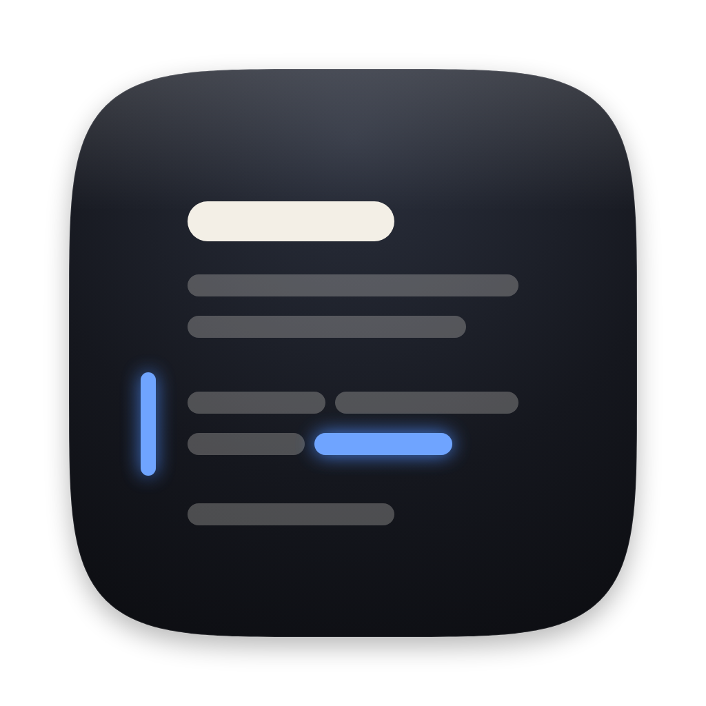
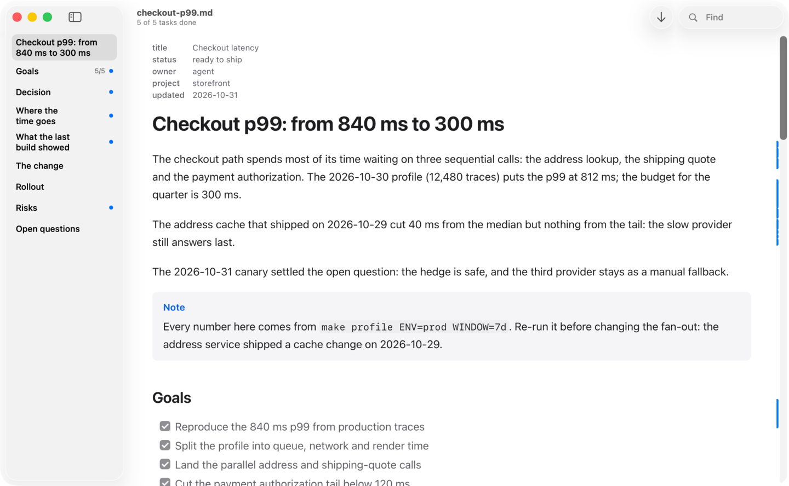

<p align="center"></p>

<h1 align="center">Readout</h1>

<p align="center">为 AI Agent 产物打造的 macOS 原生 Markdown 阅读器<br>
<a href="README.md">English</a></p>

---

<p align="center"></p>

Agent 会把计划、规格、分析报告和代码解释写成很长的 Markdown，而且会反复改写。Readout 是为此设计的只读阅读器：瞬间打开、排版干净、跟随 Agent 的写入实时更新，并清楚标出自你上次阅读以来哪里变了。

## 功能

- **实时更新，不丢阅读位置。** 监听文件（包括"写临时文件再 rename"式的原子写入），按段落增量更新，你正在读的段落不会跳动；停在文末时会像终端一样自动跟随。
- **标出变更。** 新增和修改的段落在左侧有一条细线；点击修改段落的细线，可以看到自上次阅读以来具体改了哪些词。删除处留有小标记，展开可查看被删的完整原文。真正读过后标记自动消退。按 <kbd>N</kbd> 跳到下一处，<kbd>⌘K</kbd> 全部标为已读（<kbd>⌘Z</kbd> 可撤销）。阅读进度跨重启保留。对 git 仓库中的文件，**显示 → 与上次提交比较**会标出自上次提交以来的变更（<kbd>⌘Z</kbd> 可撤销）。
- **高质量渲染。** 完整 GFM：表格、任务列表、提示块（Alerts），针对中英混排调校的排版，Shiki 代码高亮，KaTeX 数学公式，Mermaid 图表。`src/app/main.swift:42` 这样的代码引用，以及 `[main](src/app/main.swift#L42)` 这样的链接，会在编辑器中打开并定位到该行。指向另一个 Markdown 文档的链接会在下一个标签页中打开；按 <kbd>⌘W</kbd> 即可返回。
- **带进度的大纲。** 边栏列出标题，以及每个章节的任务完成数。
- **聚焦新增内容。** 一键只看未读变更（<kbd>⇧⌘K</kbd>），标题栏显示任务完成进度，悬停标题可拷贝章节链接。
- **自动打开 Agent 写的文档。** 在设置里添加 Agent 写入的文件夹（自动包含 Claude Code 的 `~/.claude/plans`）。Agent 在这里新建的 Markdown 文档会自动在 Readout 中打开，在后台进行，不会抢走终端的焦点（修改已有文件，比如 README，不会弹出）。在任何地方按 <kbd>⌃⌥⌘R</kbd> 可打开最近写入的一个。程序坞图标上的数字是等你查看的文档数：有未读变更的，或在后台打开后尚未查看的。使用 Codex？在设置里添加你的项目文件夹即可。想让 Readout 在 Agent 写入时始终在运行，可在**系统设置 → 通用 → 登录项**中添加它；登录时打开不会显示欢迎窗口。
- **Quick Look。** 在访达中选中 `.md` 文件按空格预览（需先从“应用程序”文件夹打开过一次 Readout）。
- **始终只读。** Readout 从不写入你的文件。

## 安装

从 [Releases](https://github.com/hxddh/readout/releases) 下载 `Readout-x.y.z.dmg`，打开后把 Readout 拖进"应用程序"。需要 macOS 26 或更高版本；同一个通用应用支持 Apple 芯片和 Intel Mac。

每个版本都只做了 ad-hoc 签名、未经公证，所以首次打开会被系统拦截：打开**系统设置 → 隐私与安全性**，找到关于 Readout 的提示，点击**仍要打开**。每个新版本需要这样做一次。同样的原因，每次更新后 macOS 还会再次询问是否允许 Readout 读取“文稿”“桌面”“下载”中的文件，以及是否允许它请 Xcode 打开文件并定位到行（Apple 事件）：这些权限跟随应用的签名，而 ad-hoc 签名每次构建都会变化。经过公证的版本会保留这些权限。

如需校验下载的文件，把发布页上的 `SHA256SUMS` 与 DMG、ZIP 放在同一文件夹，运行 `shasum -a 256 -c SHA256SUMS`（只下载了 DMG 时：`grep dmg SHA256SUMS | shasum -a 256 -c`）。

Readout 会通过 GitHub Releases 检查新版本（**Readout → 检查更新…**）。点击**下载更新**会把新版 DMG 存到“下载”文件夹并在访达中显示；Readout 自己不会安装任何东西。

## 隐私

渲染文档时不会发出任何网络请求：远程图片与媒体只显示为注明来源的占位按钮。只有当你点击时，Readout 才会亲自下载图片（不携带 cookie）并显示；加载一张后，同一来源的其他占位按钮可以再点一次全部加载，已加载过的图片在 Readout 运行期间再次出现时直接显示。视频与音频则改用浏览器打开。应用唯一的自动联网行为是每周一次的更新检查，可在设置中关闭。

## 命令行（可选）

配合 Agent 使用无需任何配置，设置里的文件夹就够了。如果还想要 `readout` 命令，把 App 里自带的脚本链接出来：

```sh
mkdir -p ~/.local/bin && ln -sf /Applications/Readout.app/Contents/Resources/readout ~/.local/bin/readout
```

（`~/.local/bin` 需要在 `PATH` 中。）之后 `readout plan.md` 打开文件，`readout plan.md#风险` 打开并跳到对应章节，`readout ~/.claude/plans` 打开文件夹中最新的 Markdown 文件，`readout -b plan.md` 在后台打开（作为标签页排在正在阅读的文档之后），不切换应用。`readout --version` 显示版本号。

如果想用 Claude Code hook 代替文件夹监视（不需要链接 `readout`），把下面的内容加入 `~/.claude/settings.json`；Claude Code 写入或修改的每个 Markdown 文件都会在后台打开：

```json
{
  "hooks": {
    "PostToolUse": [
      {
        "matcher": "Write|Edit|MultiEdit",
        "hooks": [
          { "type": "command", "command": "/Applications/Readout.app/Contents/Resources/readout --hook" }
        ]
      }
    ]
  }
}
```

hook 还会传入 Claude Code 的工作目录，因此保存在 `~/.claude/plans` 中的计划里的文件路径会链接到该项目中的文件。

同一条命令也可用作 [Cursor hook](https://cursor.com/docs/hooks)（`afterFileEdit`，写在 `~/.cursor/hooks.json` 中；第一个工作区文件夹即项目）：

```json
{
  "version": 1,
  "hooks": {
    "afterFileEdit": [
      { "command": "/Applications/Readout.app/Contents/Resources/readout --hook" }
    ]
  }
}
```

以及 [Gemini CLI hook](https://geminicli.com/docs/hooks/reference.md)（对其[文件工具](https://geminicli.com/docs/tools/file-system)使用 `AfterTool`，写在 `~/.gemini/settings.json` 中）：

```json
{
  "hooks": {
    "AfterTool": [
      {
        "matcher": "write_file|replace",
        "hooks": [
          { "type": "command", "command": "/Applications/Readout.app/Contents/Resources/readout --hook" }
        ]
      }
    ]
  }
}
```

### `readout-open:` URL

`readout -b` 与 `readout --hook` 通过一个 URL 打开文件，其他工具也可以使用：

```
readout-open://open?path=<绝对路径>&background=1&anchor=<章节>&root=<文件夹>
```

所有取值都需要百分号编码。`path` 必填：一个 Markdown 文件，或一个文件夹（打开其中最新的 Markdown 文件）。`background=1` 在正在阅读的文档之后打开，不把 Readout 切到前台。`anchor` 跳到某个章节（标题的 slug，如 `plan.md#risks`）。`root` 是一个已存在的绝对路径文件夹，即文档中相对路径所属的项目：该文档里的代码引用、链接和图片也会在这里查找，Readout 会为这个文件记住它。

任何应用或网页都能打开这样的 URL（浏览器会先询问你），就像它们能让访达打开一个文件一样，所以 Readout 对它的信任也仅限于此：`root` 只改变该文档中的路径指向哪些文件，不改变 Readout 能读取什么，也不会向任何地方发送任何内容。（只有 `readout` 脚本才会加上的标记并不能证明 URL 的来源：任何调用者都可以加上它。）

## 快捷键

| 按键 | 作用 |
| --- | --- |
| <kbd>N</kbd> / <kbd>⇧N</kbd>（或 <kbd>⌘]</kbd> / <kbd>⌘[</kbd>） | 下一处 / 上一处未读变更；本文档已无未读时，<kbd>N</kbd> 前往下一个有未读变更、或在后台打开后尚未查看的文档 |
| <kbd>D</kbd> | 从上到下依次显示视野内修改段落的具体变更；全部显示后再按一次收起 |
| <kbd>⌘K</kbd> | 全部标为已读（<kbd>⌘Z</kbd> 可撤销） |
| <kbd>⇧⌘K</kbd> | 只看变更 |
| <kbd>⇧⌘O</kbd> | 打开最新的 Agent 文件：已打开且有未读变更、或在后台打开后尚未查看的文档优先 |
| <kbd>⌃⌥⌘R</kbd> | 在任何地方打开最新的 Agent 文件（全局快捷键，可在设置中更改或关闭） |
| <kbd>⌘F</kbd>、<kbd>⌘G</kbd> / <kbd>⇧⌘G</kbd> | 查找、查找下一个 / 上一个 |
| <kbd>⌘+</kbd> / <kbd>⌘-</kbd> / <kbd>⌘0</kbd> | 文字大小 |
| <kbd>⌥⌘\</kbd> | 窄栏 / 宽栏 |
| <kbd>⌃⌘S</kbd> | 显示 / 隐藏边栏 |
| <kbd>⌘E</kbd> | 在编辑器中打开当前文件，定位到正在阅读的行（或选中的内容） |
| <kbd>⇧⌘R</kbd> | 在访达中显示 |
| <kbd>⇧⌘C</kbd> | 拷贝为引用：所选段落（未选中文本时为 <kbd>N</kbd> 跳到的段落）的 Markdown 源文本，附文件行号与章节 |
| <kbd>⌥⌘C</kbd> | 拷贝文件路径 |
| <kbd>⌘P</kbd> | 打印 |
| <kbd>⌥⌘W</kbd> | 关闭全部窗口 |
| <kbd>J</kbd> / <kbd>K</kbd>、<kbd>G</kbd> / <kbd>⇧G</kbd> | 滚动、跳到开头 / 结尾 |

**帮助 → Readout 帮助** 会在 Readout 中离线显示这些快捷键。

## 构建

```sh
brew install xcodegen node
make app        # 构建网页资源、生成 Xcode 工程并编译 Readout.app
make test       # 核心模块测试
```

## 许可

MIT
