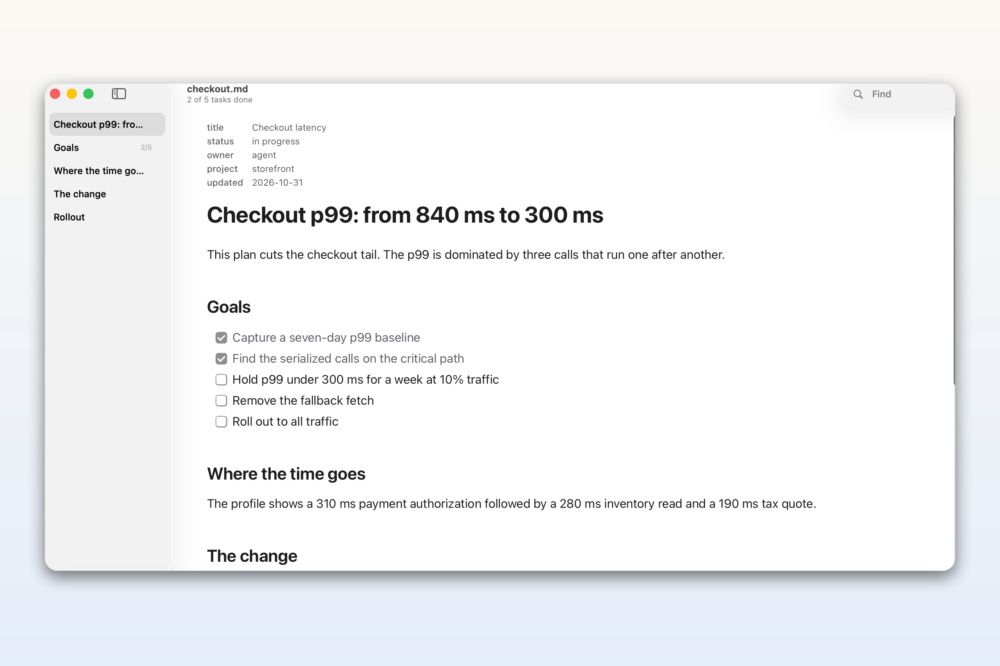
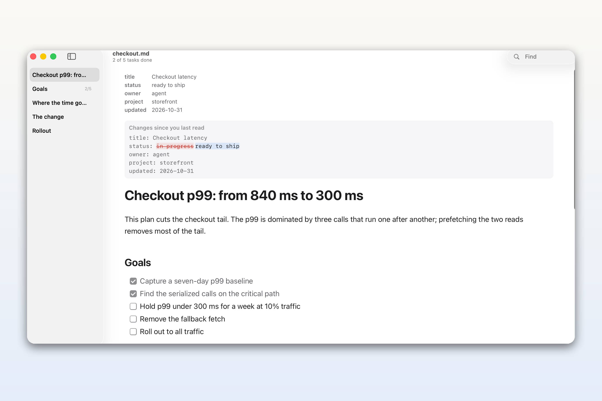
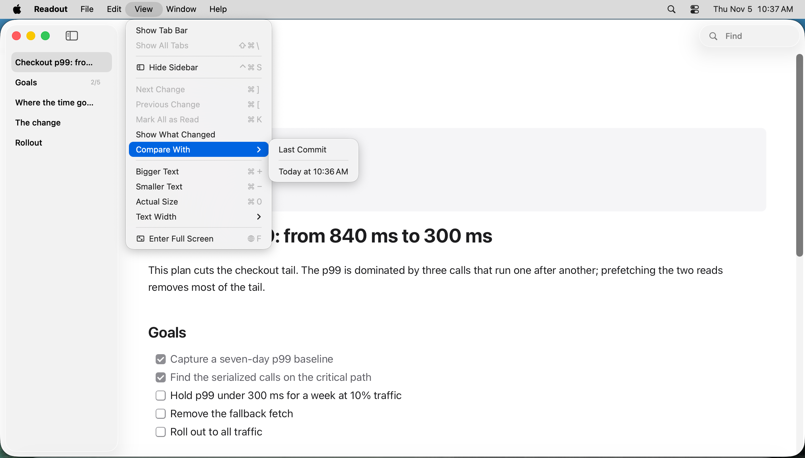
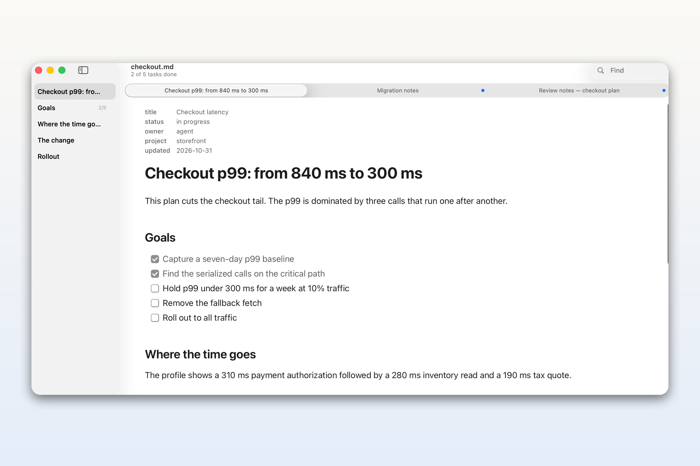
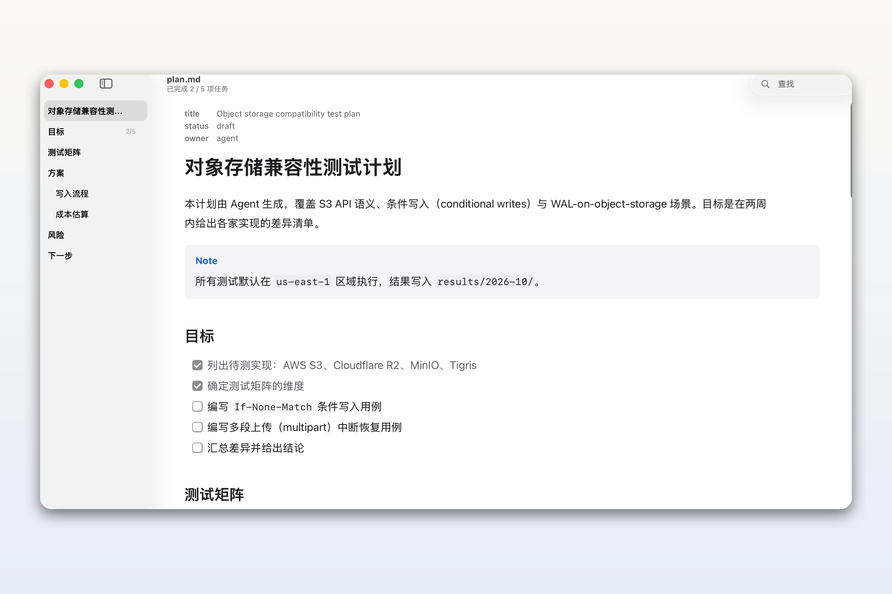
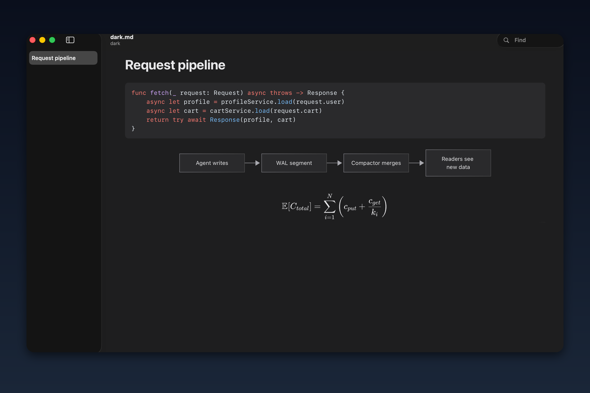
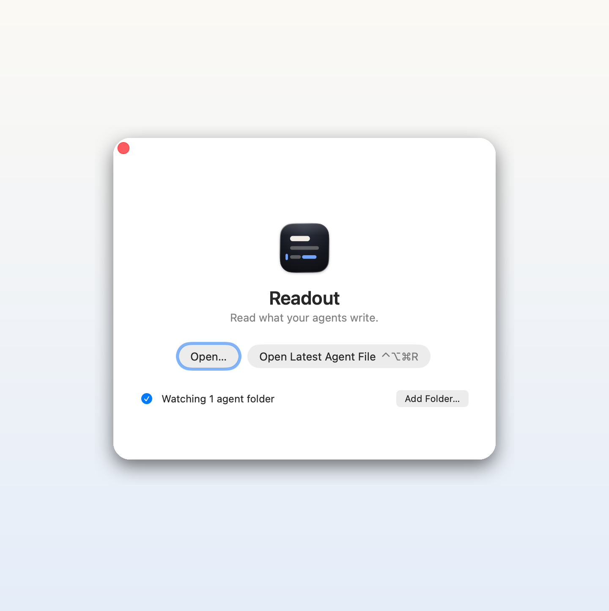

# Readout 5 in pictures

Readout 5.2 is a native macOS Markdown reader for the plans, specs and reports your coding
agents write. This gallery shows the app — not mockups — on macOS 26.3.1, captured at 2× Retina
resolution. [Download Readout 5.2.0](https://github.com/hxddh/readout/releases/tag/v5.2.0).

## A plan that is still being written

Readout follows the file as an agent rewrites it. The paragraph you are reading stays in place;
if you are at the end, the view follows the agent like a terminal. The outline lists headings and
how many tasks in each section are done, on one line each (hover a heading for its full text), and
the subtitle carries the overall count.

## See the words that changed

Changes are marked block by block. On an edited block, Readout shows exactly which words changed
since you last read it — here the plan's status moved from *in progress* to *ready to ship*.
Press <kbd>D</kbd> to show or hide the comparison, <kbd>N</kbd> to go to the next change, and
<kbd>⌘K</kbd> to mark everything read (<kbd>⌘Z</kbd> brings the marks back).

## Compare with any earlier version

Readout keeps the last 20 versions of a document it sees. **View ▸ Compare With** lists **Last
Commit** first for a file in a git repository, then the versions Readout saw, newest first, each
named by when it saw them. Choose one to mark everything that changed since that version;
<kbd>⌘Z</kbd> returns to what you had read.

## Tabs that tell you where to look

Open documents share one window as tabs, and a blue dot marks the tabs that have something new —
unread changes, or a file opened behind you that you have not looked at. <kbd>N</kbd> walks the
changes in the current document and then moves on to the next waiting document.

## Chinese and English, set properly

The typography is tuned for mixed Chinese and English: CJK punctuation, line breaking and a
column that follows the window. The interface is localized too — this is Readout with its
Chinese menus, sidebar and task count.

## Code, diagrams and math in the dark

GitHub-flavoured Markdown is rendered properly: syntax highlighting (Shiki), Mermaid diagrams and
KaTeX math, in light or dark. Readout follows the system appearance; the same document keeps its
diagram colours and code highlighting when the theme changes.

## Nothing to set up but your folders

The welcome window asks only where your agents write: add the folders and it is done. Claude Code's
`~/.claude/plans` is watched by default. New Markdown files in those folders open in the background,
without taking focus from your terminal. The `readout` command is optional; the README has the
one-line link for Terminal.

## Also in Readout 5

- Opening a document while Readout runs is fast: a spare page has its fonts ready before the
  document arrives.
- Code blocks past 3,000 lines show their first 3,000 lines, with a button for the rest; Copy,
  Find and Print still use every line.
- Requires macOS 26. One universal app for Apple silicon and Intel Macs.

[Download Readout 5.2.0](https://github.com/hxddh/readout/releases/tag/v5.2.0) ·
[Source](https://github.com/hxddh/readout)
