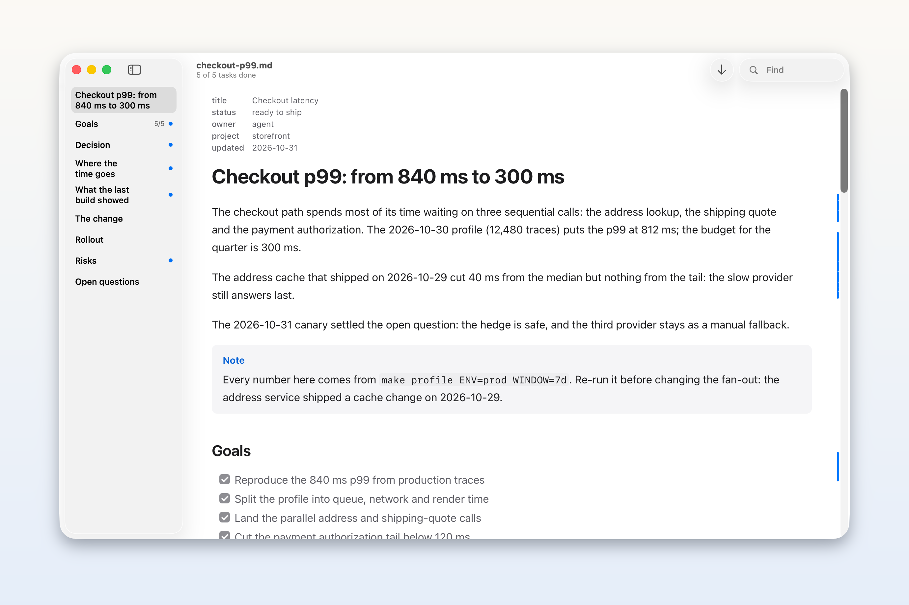
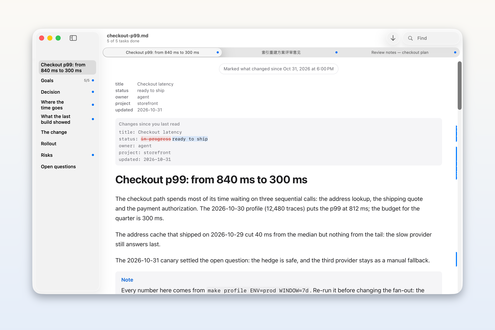
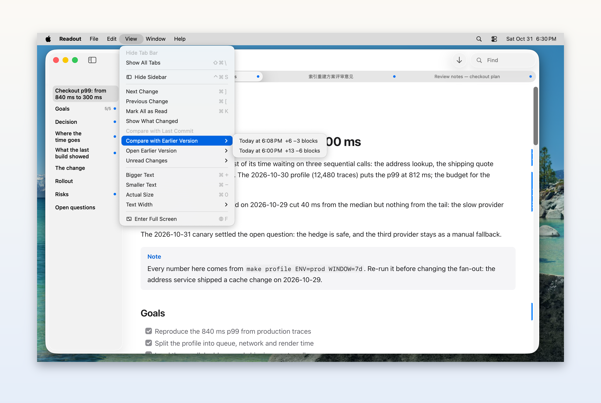
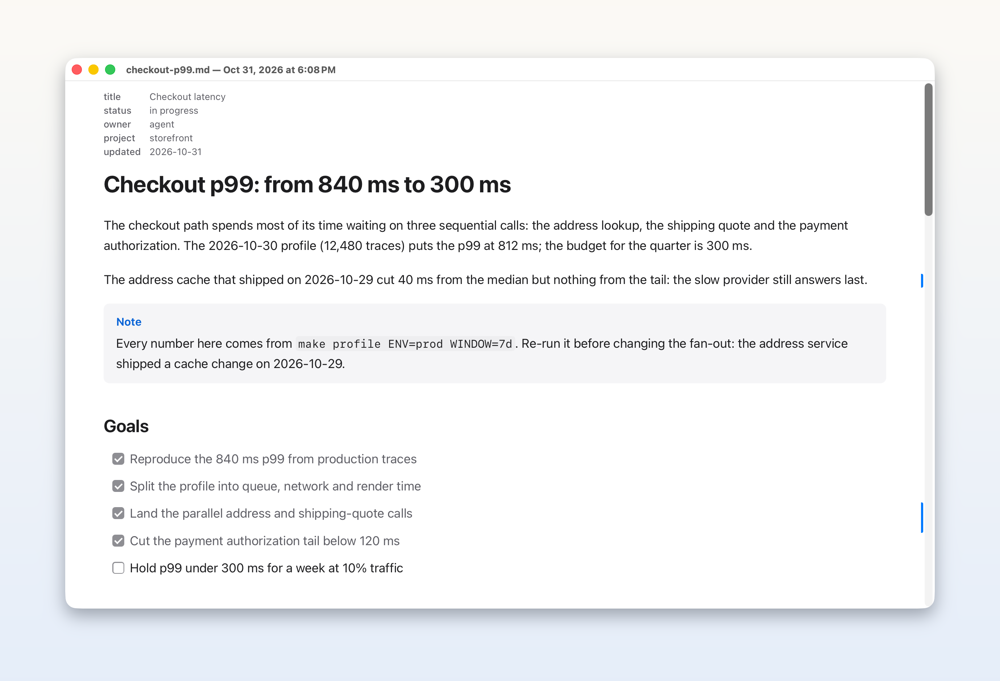
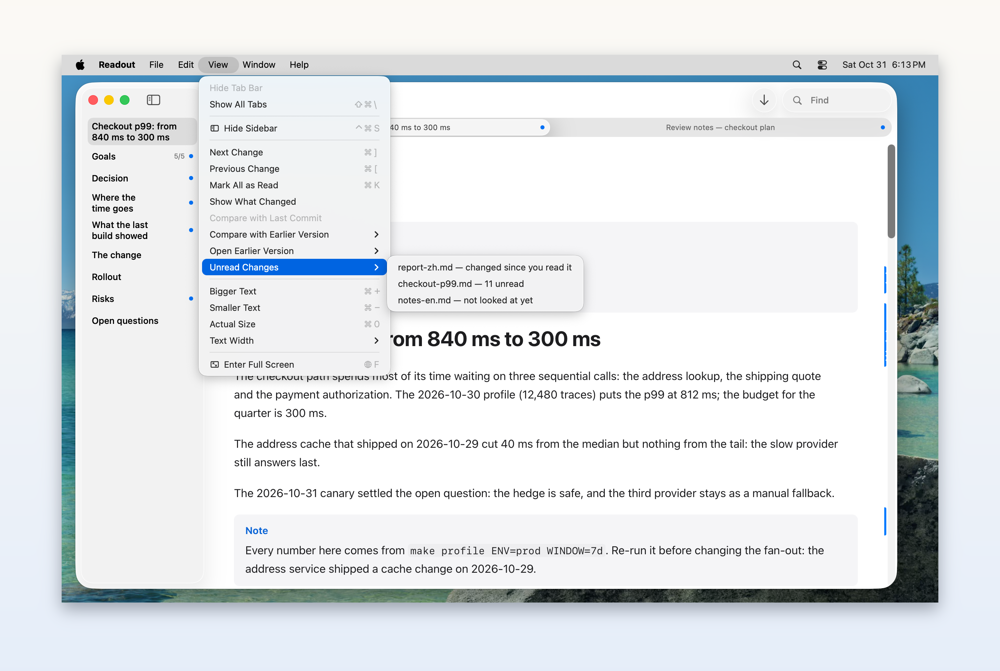
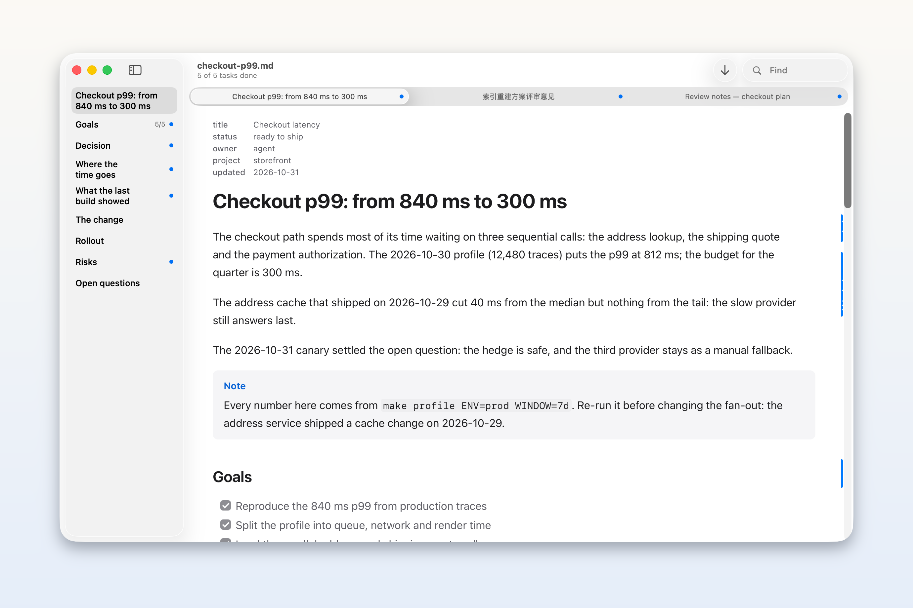
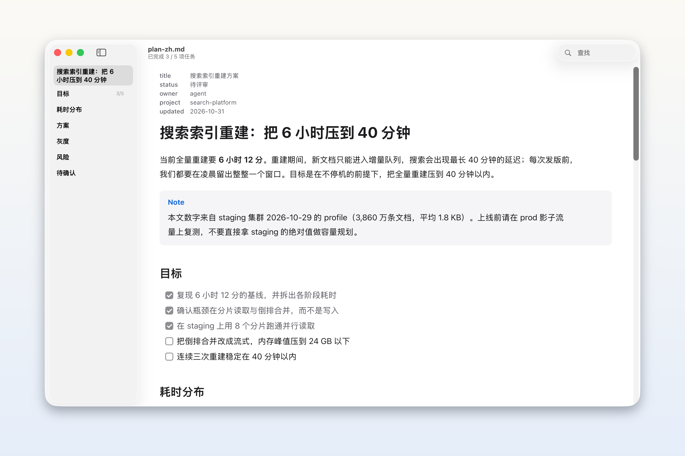
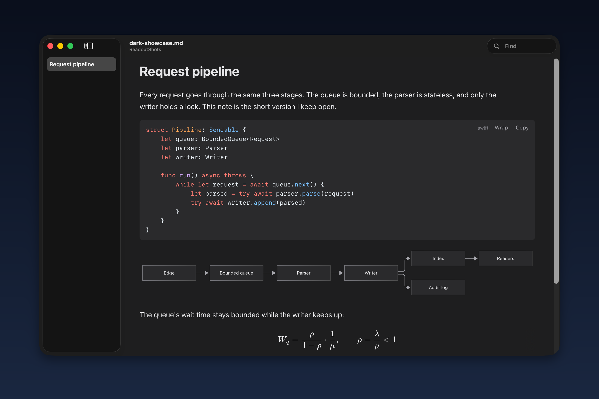
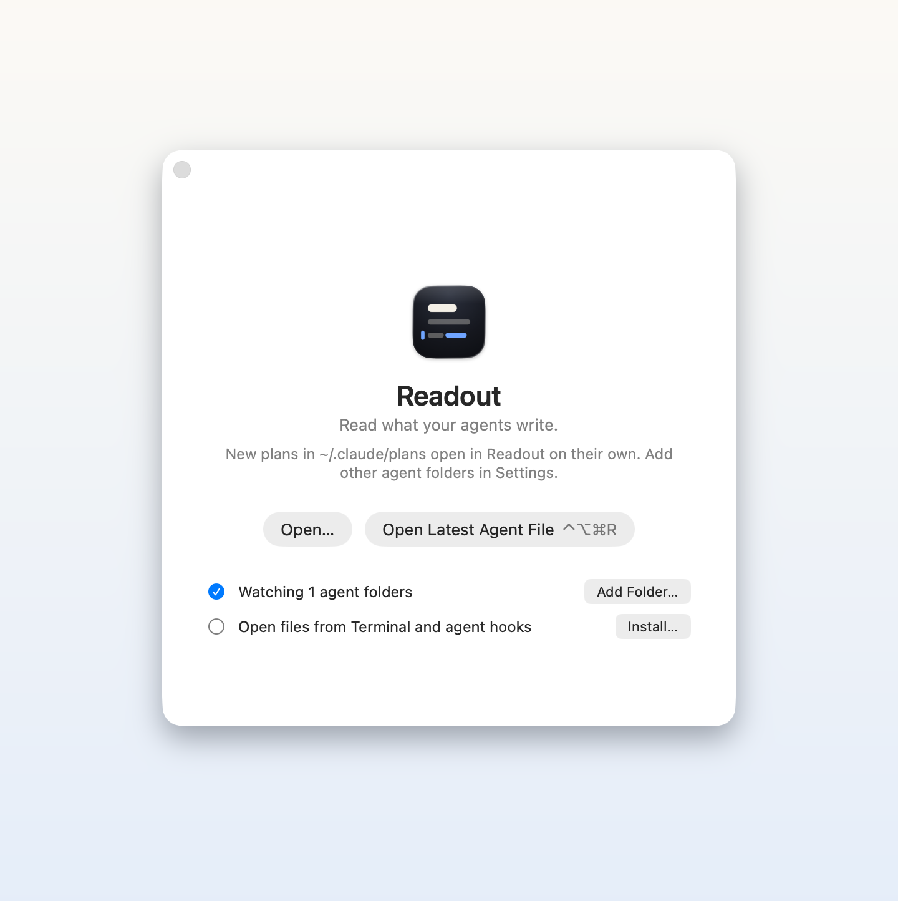

# Readout 5 图赏

Readout 5.0.0 是给 Agent 写下的计划、规格和报告用的原生 macOS Markdown 阅读器。下面的图片全部来自正式发布的 App（不是效果图），在 macOS 26.3.1 上以 2× Retina 分辨率截取。[下载 Readout 5.0.0](https://github.com/hxddh/readout/releases/tag/v5.0.0)。

## 还在写的计划，也能安心读

Agent 改写文件时，Readout 会跟着更新。你正在读的段落停在原处；如果你已经在文末，视图会像终端一样跟着 Agent 往下走。左侧目录列出各级标题和每一节完成的任务数，窗口副标题显示总进度，右侧页边的细蓝条是你还没读过的改动。

## 看清改了哪几个字

改动按块标记。对编辑过的块，Readout 会显示自上次阅读以来具体改了哪些词——这里计划状态从 *in progress* 变成了 *ready to ship*。按 <kbd>D</kbd> 显示或隐藏逐词对比，按 <kbd>N</kbd> 跳到下一处改动，按 <kbd>⌘K</kbd> 全部标为已读（<kbd>⌘Z</kbd> 可以恢复标记）。文档上方的提示会说明正在和哪个版本比较。

## 和任意历史版本对照

Readout 5 会保留它见过的每个版本文档，保留 30 天。**显示 ▸ 与较早版本比较** 会按从新到旧列出这些版本，每个都带上看到它的时间和当前差异（`+6 −3 blocks`、`+13 −6 blocks`）。选中一个版本，就能把自那以后的所有改动重新标出来；按 <kbd>⌘Z</kbd> 回到之前读到的状态。

## 只读打开历史版本

**显示 ▸ 打开较早版本** 会在独立窗口中只读打开一个历史版本。标题里写着 Readout 看到它的时间，页面则相对于再上一个版本标出改动，所以你能看清那个版本里改了什么，而不会动到磁盘上的文件。

## 所有待读文档，归到一处

**显示 ▸ 未读改动** 把所有等你看的文档集中起来，最新的在前：有未读改动的已打开文档（`11 处未读`）、在后台打开但还没看过的文档，以及 Agent 文件夹里自上次阅读后有改动的文件。选中一个，就会跳到它的第一处改动。

## 标签页上的蓝点

打开的文档以标签页共用一个窗口，蓝点表示这个标签页里有新内容——未读改动，或是在后台打开、你还没看过的文件。按 <kbd>N</kbd> 会走完当前文档的改动，再前往下一个等待处理的文档。

## 中文和英文，排得舒服

排版针对中英混排做了调整：中文标点、换行和跟随窗口的文本栏。界面也做了本地化——这张就是中文菜单、中文侧边栏和中文任务计数的 Readout。

## 暗色里的代码、图表和公式

GitHub 风格的 Markdown 会被正确渲染：代码高亮（Shiki）、Mermaid 图表和 KaTeX 公式，明暗两种主题都支持。Readout 跟随系统外观；切换主题时，同一份文档的图表配色和代码高亮也会跟着变。

## 第一次打开，就把 Readout 设好

欢迎窗口把 Readout 的设置集中在一处：添加 Agent 写文件的文件夹，安装 `readout` 命令，每完成一步就打勾。Claude Code 的 `~/.claude/plans` 默认就会被监视。这些文件夹里新建的 Markdown 文件会在后台自动打开，不会把焦点从终端抢走。

## 5.0 的其他改进

- Readout 已在运行时，文件打开更快：备用页面会提前准备好字体，文档一到就能显示。
- 超过 3,000 行的代码块只显示前 3,000 行，其余部分用一个按钮展开；复制、查找和打印仍然使用全部行。
- 需要 macOS 26。一个通用 App，同时支持 Apple silicon 和 Intel Mac。

[下载 Readout 5.0.0](https://github.com/hxddh/readout/releases/tag/v5.0.0) ·
[源码](https://github.com/hxddh/readout)
