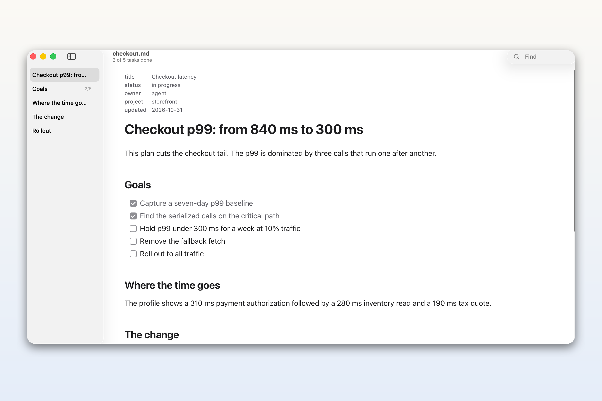
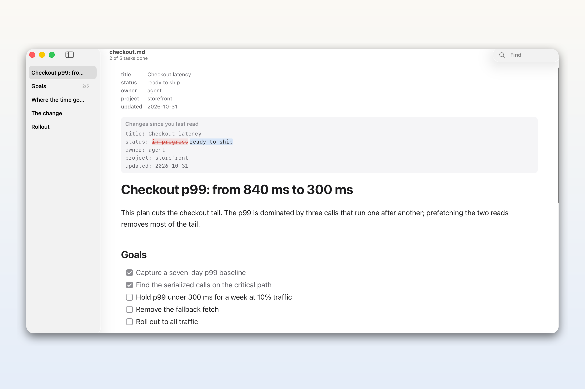
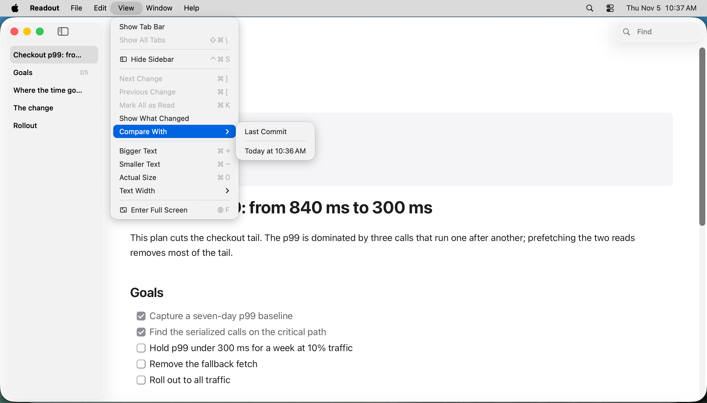
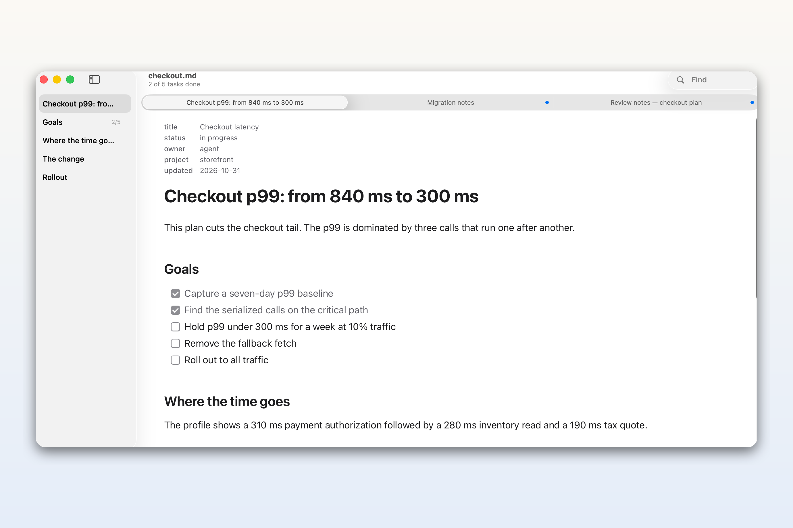
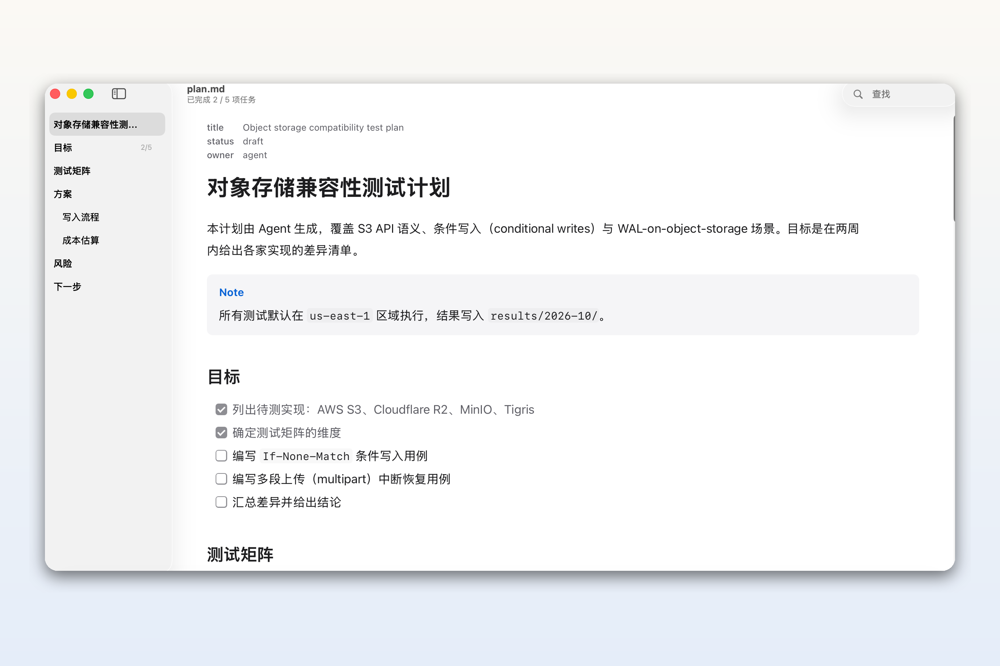
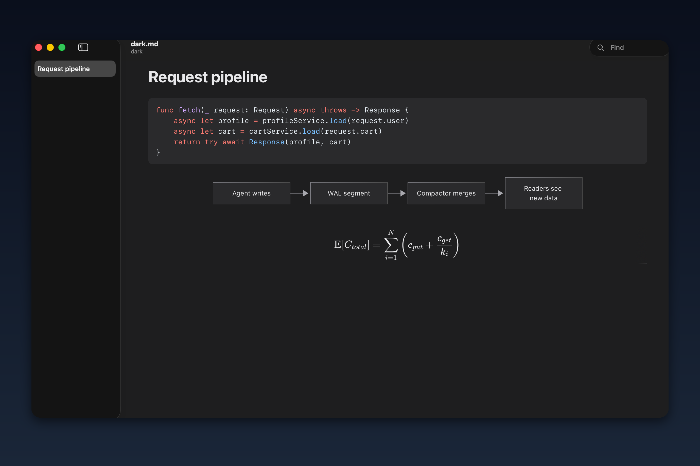
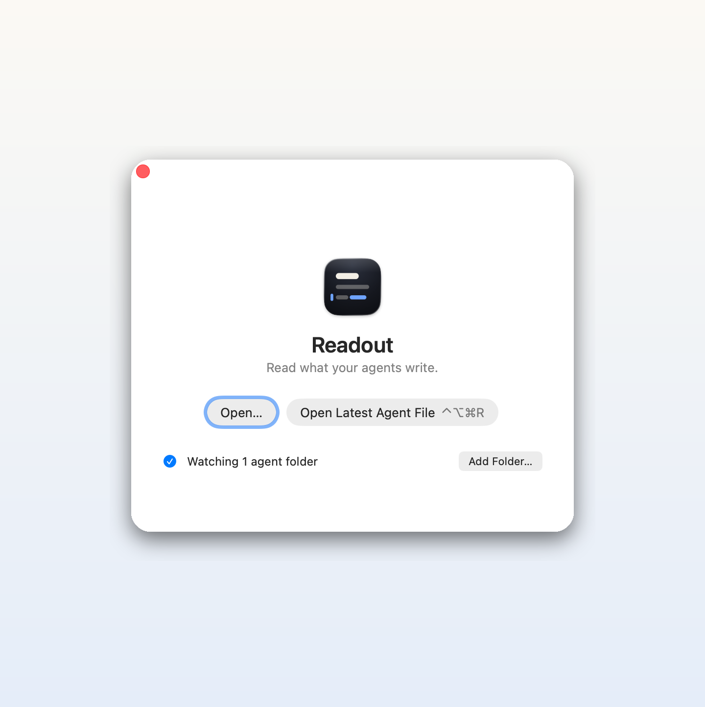

# Readout 5 图赏

Readout 5.2 是给 Agent 写下的计划、规格和报告用的原生 macOS Markdown 阅读器。下面的图片全部来自 App（不是效果图），在 macOS 26.3.1 上以 2× Retina 分辨率截取。[下载 Readout 5.2.0](https://github.com/hxddh/readout/releases/tag/v5.2.0)。

## 还在写的计划，也能安心读

Agent 改写文件时，Readout 会跟着更新。你正在读的段落停在原处；如果你已经在文末，视图会像终端一样跟着 Agent 往下走。左侧目录列出各级标题和每一节完成的任务数，每个标题一行（悬停可看全文），窗口副标题显示总进度。

## 看清改了哪几个字

改动按块标记。对编辑过的块，Readout 会显示自上次阅读以来具体改了哪些词——这里计划状态从 *in progress* 变成了 *ready to ship*。按 <kbd>D</kbd> 显示或隐藏逐词对比，按 <kbd>N</kbd> 跳到下一处改动，按 <kbd>⌘K</kbd> 全部标为已读（<kbd>⌘Z</kbd> 可以恢复标记）。

## 和任意历史版本对照

Readout 会保留它见过的最近 20 个版本文档。**显示 ▸ 比较** 在 git 仓库中先列 **上次提交**，再按从新到旧列出 Readout 见过的版本，每个都带上看到它的时间。选中一个版本，就能把自那以后的所有改动重新标出来；按 <kbd>⌘Z</kbd> 回到之前读到的状态。

## 标签页上的蓝点

打开的文档以标签页共用一个窗口，蓝点表示这个标签页里有新内容——未读改动，或是在后台打开、你还没看过的文件。按 <kbd>N</kbd> 会走完当前文档的改动，再前往下一个等待处理的文档。

## 中文和英文，排得舒服

排版针对中英混排做了调整：中文标点、换行和跟随窗口的文本栏。界面也做了本地化——这张就是中文菜单、中文侧边栏和中文任务计数的 Readout。

## 暗色里的代码、图表和公式

GitHub 风格的 Markdown 会被正确渲染：代码高亮（Shiki）、Mermaid 图表和 KaTeX 公式，明暗两种主题都支持。Readout 跟随系统外观；切换主题时，同一份文档的图表配色和代码高亮也会跟着变。

## 只需设置 Agent 文件夹

欢迎窗口只问 Agent 在哪里写文件：添加文件夹就完成了。Claude Code 的 `~/.claude/plans` 默认就会被监视。这些文件夹里新建的 Markdown 文件会在后台自动打开，不会把焦点从终端抢走。`readout` 命令是可选的；需要在终端使用它时，README 里有一行链接命令。

## Readout 5 的其他改进

- Readout 已在运行时，文件打开更快：备用页面会提前准备好字体，文档一到就能显示。
- 超过 3,000 行的代码块只显示前 3,000 行，其余部分用一个按钮展开；复制、查找和打印仍然使用全部行。
- 需要 macOS 26。一个通用 App，同时支持 Apple silicon 和 Intel Mac。

[下载 Readout 5.2.0](https://github.com/hxddh/readout/releases/tag/v5.2.0) ·
[源码](https://github.com/hxddh/readout)
