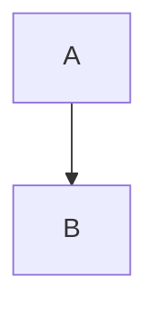

# Copy cases

Setext heading
--------------

A paragraph with *emphasis*, _underscore emphasis_, **strong**, ~~struck~~, `inline code`, a `` code with ` tick ``, a [link](https://example.com/a "Title"), a [reference link][ref], an autolink <https://example.com/b>, a bare URL https://example.com/c and an escaped \*star\*.
Second line after a soft break,  
and a hard break before this line.

[ref]: https://example.com/ref


Status: green
Owner: platform

- tight one
- tight two
  - nested **a**
  - nested b
- tight three

* star marker
* second

1. first
2. second
   1. inner
3. third

7) starts at seven
8) eight

- loose one

- loose two

  With a second paragraph.

- [ ] Task open
- [x] Task done
- [ ] Loose task

  Step 1

> A quote with **bold**
> and a second line.
>
> > Nested quote.

> [!WARNING]
> Watch the `flag`.

```swift
let x = 1
print(x)
```

~~~
tilde fence
~~~

    indented code

| Left | Center | Right |
| :--- | :----: | ----: |
| a \| pipe | `b` | **c** |
| 中文 | 2 | 3 |

Inline math $E = mc^2$ here.

$$
\int_0^1 x\,dx
$$

A footnote reference.[^n]

[^n]: The note text.

<details>
<summary>More</summary>

Hidden **content**.

</details>

<div align="center">HTML block</div>



***

中文段落，*强调*与`代码`，以及[链接](https://example.cn)。
