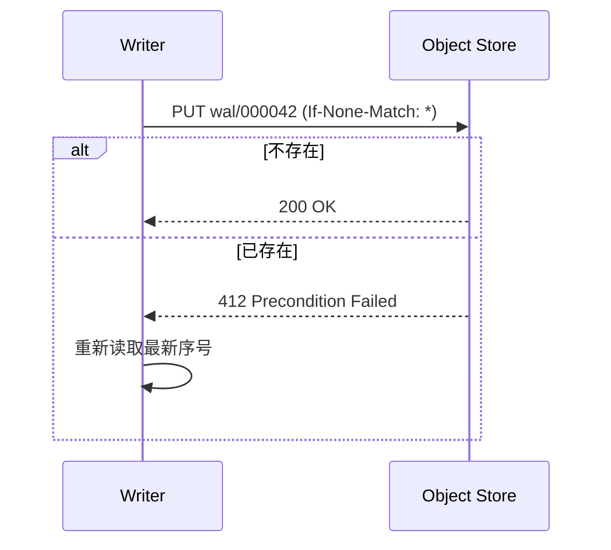

# 对象存储兼容性测试计划

本计划由 Agent 生成，覆盖 S3 API 语义、条件写入（conditional writes）与 WAL-on-object-storage 场景。目标是在两周内给出各家实现的差异清单。

> [!NOTE]
> 所有测试默认在 `us-east-1` 区域执行，结果写入 `results/2026-10/`。

## 目标

- [x] 列出待测实现：AWS S3、Cloudflare R2、MinIO、Tigris
- [x] 确定测试矩阵的维度
- [ ] 编写 `If-None-Match` 条件写入用例 EARLY-EDIT-OK
- [ ] 编写多段上传（multipart）中断恢复用例
- [ ] 汇总差异并给出结论

## 测试矩阵

| 实现 | PutObject If-None-Match | CopyObject 条件 | List 一致性 | 延迟 p99 (ms) |
|:--|:--:|:--:|:--|--:|
| AWS S3 | 支持 | 支持 | 强一致 | 41 |
| Cloudflare R2 | 支持 | 部分 | 强一致 | 58 |
| MinIO | 支持 | 支持 | 强一致 | 12 |
| Tigris | 支持 | 未知 | 最终一致 | 33 |

## 方案

1. 在每个实现上创建隔离的 bucket。
2. 通过统一的 harness 发送请求，记录响应头与状态码。
3. 将结果与 AWS S3 的行为逐项比对。

The harness lives in `src/harness/main.go` and is invoked like this:

```bash
go run ./src/harness --target r2 --suite conditional-writes --out results/r2.json
```

Core of the conditional write check:

```go
func putIfAbsent(ctx context.Context, c *s3.Client, key string, body []byte) (bool, error) {
	_, err := c.PutObject(ctx, &s3.PutObjectInput{
		Bucket:      aws.String(bucket),
		Key:         aws.String(key),
		Body:        bytes.NewReader(body),
		IfNoneMatch: aws.String("*"),
	})
	var apiErr smithy.APIError
	if errors.As(err, &apiErr) && apiErr.ErrorCode() == "PreconditionFailed" {
		return false, nil
	}
	return err == nil, err
}
```

### 写入流程



### 成本估算

单次写入成本近似为 $C = n \cdot (c_{put} + c_{get}/k)$，其中 $k$ 为批量大小。整体期望：

$$
\mathbb{E}[C_{total}] = \sum_{i=1}^{N} \left( c_{put} + \frac{c_{get}}{k_i} \right)
$$

> [!WARNING]
> Tigris 的 List 结果在高并发下可能出现短暂不一致，测试需要加入重试与等待。

## 风险

- 各家对 `x-amz-checksum-*` 头的支持不一致，可能导致校验失败。
- MinIO 的本地部署延迟不能代表生产环境。
- R2 对 `CopyObject` 条件头的支持文档不完整，需要实测确认。

## 下一步

完成条件写入用例后，再扩展到 multipart 和版本化 bucket。详见 https://docs.aws.amazon.com/AmazonS3/latest/userguide/conditional-requests.html 。


